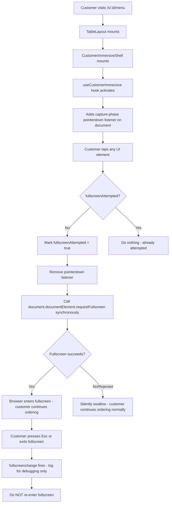

# Customer Immersive Fullscreen — Implementation Plan

## Architecture Decision

### Placement: `app/s/[servicePointId]/layout.tsx`

This layout is the **smallest shared customer shell** that wraps the entire QR ordering journey:

```
app/s/[servicePointId]/layout.tsx
├── CustomerThemeProvider          ← branding/theme context
│   └── CustomerImmersiveShell    ← **NEW: first-interaction fullscreen hook**
│       └── {children}            ← all customer pages
├── OrderEtaWidget                ← floating ETA widget
└── MenuButton                    ← floating menu button
```

**Why this location:**

1. It wraps ALL customer ordering pages under `/s/:servicePointId/*`:
   - `/s/:id/menu` — main menu
   - `/s/:id/order` — cart/checkout
   - `/s/:id/orders` — order history
   - `/s/:id/status` — order status
   - `/s/:id/confirmation` — order confirmation
   - `/s/:id/waitstaff-request` — waitstaff request

2. It does NOT affect:
   - `/q/:businessId/:servicePointId` — QR bootstrap (redirects away, no UI)
   - `/b/:countryCode/:businessSlug` — public hub
   - `/reserve/*` — reservation flow
   - `/reservation/*` — reservation confirmation
   - `/scan` — QR scanner
   - `/owner/*` — owner dashboard
   - `/waitstaff/*` — waitstaff dashboard
   - `/login`, `/onboarding`, `/setup-account` — auth flows

3. It's already a `"use client"` component, so no conversion needed.

4. The layout mounts once per customer visit and persists across client-side navigations between `/s/:id/menu`, `/s/:id/order`, `/s/:id/status`, etc. — the `fullscreenAttempted` ref survives these navigations.

---

## Component Architecture



---

## Files to Create/Modify

### 1. NEW: `hooks/use-customer-immersive.ts`

A custom hook that:
- Uses `useRef` for `fullscreenAttempted` (survives re-renders, resets on unmount)
- On mount: adds a **capture-phase** `pointerdown` listener on `document`
- On first eligible interaction:
  1. Sets `fullscreenAttempted.current = true`
  2. Removes the listener immediately
  3. Calls `document.documentElement.requestFullscreen()` **synchronously** (within the user gesture)
  4. Catches and silently swallows any rejection
- Also listens for `fullscreenchange` for dev-only console logging
- Cleans up all listeners on unmount
- Handles Safari via `webkitRequestFullscreen` fallback

**Key design decisions:**
- `pointerdown` (not `click`) — fires earlier, more reliable for user activation
- `{ capture: true }` — catches events before they reach target elements
- No `preventDefault()` or `stopPropagation()` — original interaction proceeds normally
- Synchronous `requestFullscreen()` call — preserves browser user-activation context
- `document.documentElement` as target — includes portal-based dialogs/modals/popovers

### 2. MODIFY: `app/s/[servicePointId]/layout.tsx`

Add a small inner component `CustomerImmersiveShell` that calls the hook:

```tsx
function CustomerImmersiveShell({ children }: { children: ReactNode }) {
  useCustomerImmersive()
  return <>{children}</>
}
```

Wrap children with it inside `CustomerThemeProvider`.

**Change is minimal:** ~5 lines added to the existing layout.

---

## Behavior Specification

| Scenario | Behavior |
|----------|----------|
| First customer tap/click | Fullscreen attempted synchronously; original action proceeds |
| Fullscreen succeeds | Customer is in immersive mode; all portals/dialogs visible |
| Fullscreen rejected/unsupported | Silently ignored; ordering works normally |
| Customer presses Esc | Exits fullscreen; does NOT re-enter on next interaction |
| Customer navigates between /s/:id/* pages | Layout persists; no re-attempt |
| Customer refreshes page | New mount → new opportunity for first-interaction fullscreen |
| Payment redirect (Stripe) | May exit fullscreen; acceptable; no re-entry |
| iOS Safari | `webkitRequestFullscreen` attempted; likely rejected; ordering unaffected |

---

## What This Does NOT Do

- No backend changes
- No database state
- No business settings
- No owner configuration
- No analytics
- No localStorage persistence
- No dedicated "Fullscreen" button
- No error toasts on failure
- No modification to payment/session/order/cart logic
- No changes to owner/staff/kitchen/bar/admin routes
- No interference with existing `useFocusMode` (staff-only hook)

---

## Reuse of Existing Patterns

The implementation follows the pattern established by [`hooks/use-focus-mode.ts`](hooks/use-focus-mode.ts:17):
- Same `document.documentElement` fullscreen target
- Same Safari `webkitRequestFullscreen` fallback
- Same `fullscreenchange` listener pattern
- Same silent error handling

But differs in key ways:
- **Automatic** on first interaction (not manual toggle)
- **One-attempt-only** (not toggleable)
- **No UI state** (no `isFocusMode` equivalent)
- **Customer-only** scope (not staff)